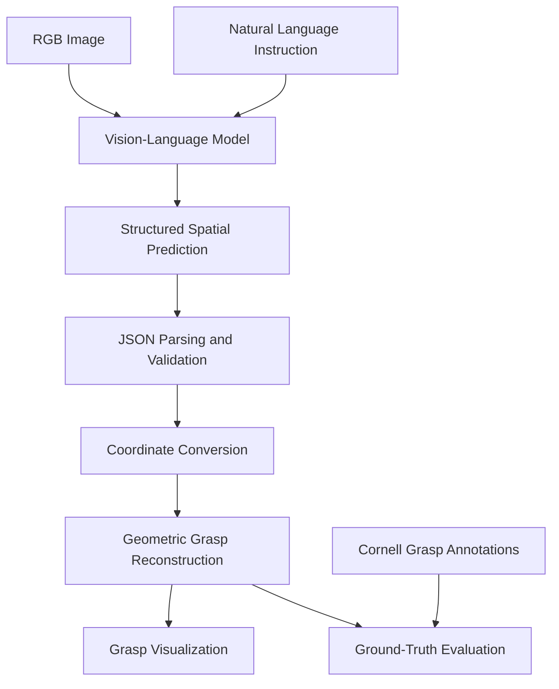
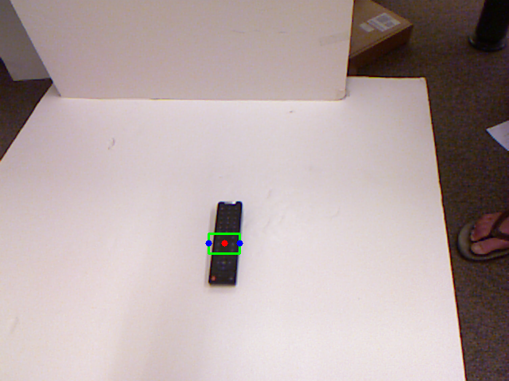

# VLM-Grasping

Language-guided robotic grasp prediction using vision-language models, prompt engineering, and deterministic geometric reconstruction.

## Overview

VLM-Grasping is an ongoing research project at the Design Innovation and Intelligent Manufacturing (DIIM) Lab at the University of Guelph, investigating the integration of vision-language models (VLMs) into robotic grasp planning.

The project explores how natural language instructions and visual information can be translated into geometric grasp representations, enabling robots to interpret human instructions and identify suitable object grasping configurations.

The current implementation utilizes Google Gemini for semantic reasoning and spatial localization, combined with deterministic geometric calculations for two-dimensional grasp reconstruction.

## Research Objectives

- Investigate the capabilities and limitations of VLMs in robotic grasp prediction.
- Evaluate the impact of prompt engineering on grasp localization, accuracy, and consistency.
- Investigate normalized spatial representations for reliable coordinate prediction.
- Reconstruct grasp geometry from VLM-predicted opposing contact points.
- Benchmark predicted grasps against annotated ground-truth grasp rectangles.
- Develop a model-independent framework for integrating and evaluating multiple VLMs.

## Methodology

The proposed approach separates semantic and spatial reasoning from deterministic geometric computation.



The VLM predicts normalized spatial coordinates corresponding to a grasp centre and two opposing gripper contact points. These coordinates are converted into the original image coordinate system, allowing grasp centre, closing orientation, and contact separation to be calculated mathematically.

This approach reduces reliance on the VLM for deterministic geometric calculations while leveraging its semantic and spatial reasoning capabilities.

## Prompting Strategies

Four prompting strategies are being investigated:

| ID | Strategy | Description |
|---|---|---|
| P1 | Basic zero-shot | Natural language grasp prediction without explicit output constraints |
| P2 | Structured pixel coordinates | Direct prediction of pixel-based grasp parameters |
| P3 | Structured normalized geometry | Direct geometric prediction using normalized coordinates |
| P4 | Normalized contact points | Contact-point prediction with deterministic geometric reconstruction |

## Dataset

The Cornell Grasping Dataset is utilized for preliminary experimentation and quantitative evaluation.

The local dataset contains:

- 896 RGB images.
- 885 positive grasp annotation files.
- Depth images and point cloud data.
- Positive and negative grasp annotations.

RGB images are provided to the VLM, while ground-truth grasp annotations are reserved for evaluation.

## Preliminary Results

Initial experiments were conducted using Gemini 3.6 Flash on Cornell sample `pcd0100`, containing a remote control.

| Strategy | Grasp Centre (px) | Visual Localization | Latency |
|---|---|---|---:|
| P1 — Basic zero-shot | (282.88, 306.24) | On target | 144.42 s |
| P2 — Structured pixel | (442.00, 306.00) | Off target | 16.96 s |
| P4 — Normalized contact points | (281.60, 306.24) | On target | 13.56 s |

The normalized contact-point approach produced an internally consistent grasp representation:

- Grasp centre: (281.60, 306.24) pixels.
- Contact separation: 39.68 pixels.
- Gripper closing orientation: 0°.
- Centre consistency error: 0.00 pixels.

Preliminary observations suggest that normalized spatial prediction combined with external geometric computation may improve the reliability of grasp localization. Further experiments are required to establish generalized performance.

These results represent individual inference trials rather than aggregate benchmark performance.

## Grasp Visualization



- **Red:** Calculated grasp centre.
- **Blue:** Predicted opposing contact points.
- **Green:** Reconstructed grasp rectangle.

The rectangle height is currently assigned for visualization purposes and has not yet been standardized for quantitative evaluation.

## Evaluation

The proposed evaluation framework utilizes:

- Intersection over Union (IoU).
- Grasp orientation error.
- Grasp detection success rate.
- Spatial localization consistency.
- Structured output validity.
- Inference latency.

Quantitative evaluation against Cornell ground-truth annotations is ongoing.

## Technology Stack

| Technology | Application |
|---|---|
| Python | Core implementation |
| Google Gen AI SDK | Multimodal model inference |
| Gemini | Semantic reasoning and spatial localization |
| OpenCV | Grasp visualization |
| NumPy | Numerical computation |
| Pillow | Image processing |
| Cornell Grasping Dataset | Experimental evaluation |

## Getting Started

### Environment Setup

```bash
python -m venv .venv
source .venv/bin/activate

pip install google-genai python-dotenv pillow numpy opencv-python
```

### API Configuration

Create a `.env` file in the project root:

```env
GEMINI_API_KEY=your_api_key
GEMINI_MODEL=gemini-3.6-flash
```

### Dataset Configuration

Place the Cornell Grasping Dataset under:

```text
data/cornell/
```

### Run Experiments

```bash
python test_gemini.py
python test_vision.py
python test_structured.py
python test_normalized.py
```

### Visualize Grasp Prediction

```bash
python visualize_grasp.py
```

## Research Affiliation

**Design Innovation and Intelligent Manufacturing (DIIM) Lab**

School of Engineering, University of Guelph

Research supervised by Dr. Sheng Yang.

## Project Status

This repository is under active development as part of ongoing undergraduate research in language-guided robotic manipulation and intelligent manufacturing.
